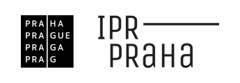
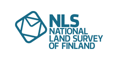

# ALEX: AI Local climate and Energy eXchange

ALEX brings AI into Local Digital Twins for climate and energy planning in Helsinki and Prague. It is a pilot of [LDT4SSC](https://ldt4ssc.eu) (Local Digital Twins for Smart and Sustainable Communities), Work Strand 3, and runs from 31 August 2026 to 29 February 2028.

## The pilots

- **Helsinki** develops the city's Energy and Climate Atlas into a Local Digital Twin capable of predictive analysis: prioritising energy retrofits across the building stock, estimating the effect of climate actions, and making the results understandable to private and public actors.
- **Prague** builds a Local Digital Twin that brings energy, environmental and spatial data into the early stages of urban planning, so that development scenarios can be simulated before they are built.

Both pilots share an interoperability layer based on Location Europe and OGC APIs, a Model Context Protocol (MCP) tool for AI-ready access to geospatial data, and a Prometheus-X data space connector for trusted data exchange.

## Start here

**[ldt4ssc-alex](https://github.com/ALEX-LDT/ldt4ssc-alex)** is the public front door of ALEX: the pilot's record as an LDT4SSC pilot. It holds the pilot's progress Updates, documentation and descriptions of its outputs, and links to the component repositories as they are published. Its Updates also appear on the [LDT4SSC Knowledge Hub](https://knowledgehub.ldt4ssc.eu/).

## How we work

- Each component has its own repository and is published here once it is ready for reuse. Mature components also go to the LDT Toolbox Marketplace and the LDT4SSC Assets and Services Repository.
- Every change goes through a pull request reviewed by another partner.
- Code is licensed under Apache-2.0 and content under CC BY 4.0, unless a repository states otherwise.

## Partners

| Partner | Country | Role |
| --- | --- | --- |
| [City of Helsinki](https://www.hel.fi/en) | Finland | Coordinator, Helsinki pilot |
| [Forum Virium Helsinki](https://forumvirium.fi/en/) | Finland | Development, Helsinki pilot |
| [Prague Institute of Planning and Development (IPR Praha)](https://iprpraha.cz/en) | Czechia | Prague pilot |
| [Operator ICT](https://operatorict.cz/en) | Czechia | AI components, Prague pilot |
| [Institute of Computer Science of the Czech Academy of Sciences](https://www.cs.cas.cz/index.php/en) | Czechia | Atmospheric and micro-scale simulation |
| [National Land Survey of Finland, Finnish Geospatial Research Institute](https://www.maanmittauslaitos.fi/en/research) | Finland | Geospatial interoperability, Location Europe |
| [Visions](https://visionspol.eu) | France | Data space connector |

<!--
Partner logos are shown with each partner's written approval (Consortium
Agreement, Section 8.4.5). Keep them no larger than the EU emblem under
Funding (Pilot Grant Agreement, Article 14.3).
-->

  
  
  
  
  
  
  

## Security

To report a vulnerability, follow the [security policy](https://github.com/ALEX-LDT/.github/blob/main/SECURITY.md). Do not open a public issue.

## Funding

  
  

ALEX is a pilot of the LDT4SSC project, funded under the Digital Europe Programme, Grant Agreement No 101226211.

Funded by the European Union. Views and opinions expressed are however those of the author(s) only and do not necessarily reflect those of the European Union or Digital Europe Programme. Neither the European Union nor the Digital Europe Programme can be held responsible for them. The LDT4SSC consortium and the European Commission are not responsible for any use that may be made of the information it contains.
